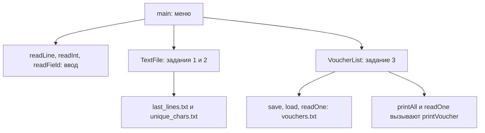

# Разбор всех классов, функций и методов лабораторной № 4

Этот документ объясняет текущий [main.cpp](main.cpp): что где находится, кто кого вызывает и как меняются данные. В исходнике два собственных класса, одна структура и 20 написанных функций и методов, включая конструкторы и деструктор.

Номера строк и ссылки соответствуют версии кода с классами. Инструкция запуска находится в [README.md](README.md), основы работы с файлами — в [THEORY.md](THEORY.md), ответы преподавателю — в [CONTROL_QUESTIONS.md](CONTROL_QUESTIONS.md).

## 1. Карта программы

Вся программа находится в одном `main.cpp`. Место определения функции в файле не задаёт порядок её выполнения: выполнение начинается с `main`, а остальные функции работают при вызове.

| Где начинается | Что находится | Назначение |
| --- | --- | --- |
| [Строка 16](main.cpp#L16) | `readLine` | Ввод одной строки с клавиатуры |
| [Строка 25](main.cpp#L25) | `readInt` | Ввод целого числа с проверкой |
| [Строка 37](main.cpp#L37) | `readField` | Ввод текста в поле структуры |
| [Строка 48](main.cpp#L48) | Класс `TextFile` | Задания 1 и 2 с текстовыми файлами |
| [Строка 136](main.cpp#L136) | Структура `Voucher` | Данные одной путёвки |
| [Строка 145](main.cpp#L145) | `printVoucher` | Вывод одной путёвки |
| [Строка 154](main.cpp#L154) | Класс `VoucherList` | Динамический массив путёвок и задание 3 |
| [Строка 279](main.cpp#L279) | `main` | Меню, создание объектов и вызов нужных действий |

Общая связь частей:



### Функция, метод, класс и объект

**Функция** — отдельный участок программы с именем. Например, `readInt(...)` можно вызвать напрямую.

**Метод** — функция, объявленная внутри класса. Она вызывается у конкретного объекта:

```cpp
vouchers.save();
```

Здесь `vouchers` — объект, а `save` — его метод. Метод работает с данными этого объекта.

**Класс** описывает, какие данные хранит объект и какие действия доступны. В строке `VoucherList vouchers;` класс — `VoucherList`, объект — `vouchers`.

**Структура** тоже описывает тип данных. Здесь `Voucher` объединяет поля одной путёвки, а `VoucherList` управляет массивом таких структур. У `Voucher` нет собственных методов, написанных в программе.

В классе содержимое до `public:` закрыто для прямого обращения из `main`. После `public:` находятся доступные снаружи методы. Поля нашей структуры `Voucher` доступны напрямую: например, `voucher.number`.

## 2. Три функции ввода

### 2.1. readLine — получить строку

[Определение: строка 16](main.cpp#L16).

```cpp
string readLine(string prompt)
```

Получает `prompt` — текст приглашения, например `"Название санатория: "`. Возвращает введённую строку типа `string`.

Сначала выводит приглашение через `cout`, затем вызывает `getline(cin, line)`. Поэтому строка может содержать пробелы: Ф.И.О. или название читается целиком. Если ввод закончился и строку получить не удалось, выбрасывается `runtime_error("Ввод завершён.")`.

Эта функция используется внутри `readInt`, `readField` и непосредственно в `main`. Она сама не проверяет, пустая ли строка: конкретные требования проверяет вызывающий код.

### 2.2. readInt — получить целое число в диапазоне

[Определение: строка 25](main.cpp#L25).

```cpp
int readInt(string prompt, int minimum, int maximum)
```

Получает приглашение и две включённые границы допустимого значения. Возвращает проверенное число типа `int`.

Например:

```cpp
int k = readInt("K (от 1 до 9): ", 1, 9);
```

Функция повторяет попытки в `while (true)`, пока не сможет выполнить `return value`. Каждый раз она:

1. Читает всю строку через `readLine`.
2. Создаёт из неё `stringstream input` — поток для разбора текста в памяти.
3. Пытается извлечь целое число в `value`.
4. Пытается извлечь ещё один непробельный символ в `extra`.
5. Проверяет границы.

Основное условие:

```cpp
input >> value && !(input >> extra) && value >= minimum && value <= maximum
```

Оно означает: число прочитано, лишних символов нет, значение входит в диапазон. `&&` проверяет части слева направо и останавливается на первой неудачной.

Для `2.5` прочитается целое `2`, но останется точка — ввод отклоняется. Для `abc` уже число прочитать нельзя. Для ` 2 ` лишних непробельных символов нет, поэтому такой ввод принимается.

В `main` функция проверяет пункт меню, `K`, номер путёвки и порядковые номера записей. Верхняя граница `INT_MAX` обозначает максимальное значение `int`.

### 2.3. readField — записать текст в поле структуры

[Определение: строка 37](main.cpp#L37).

```cpp
void readField(string prompt, char field[], int size)
```

Получает приглашение, массив символов `field` и его размер в байтах `size`. Значение через `return` не возвращает: изменяет переданный массив.

Пример вызова:

```cpp
readField("Ф.И.О.: ", voucher.fullName, sizeof(voucher.fullName));
```

Функция читает строку и проверяет, что она непустая и её длина меньше размера поля. Для поля в 100 байтов допускается до 99 байтов текста: ещё один байт нужен для завершающего символа `\0`.

После проверки `line.c_str()` предоставляет текст с завершающим нулём, а `strcpy` копирует его в `field`. Изменения сразу попадают в `voucher.fullName`: содержимое массива при передаче не копируется в отдельный массив функции.

Пустая или слишком длинная строка запрашивается заново. В UTF-8 размер считается в байтах, поэтому русских букв в поле помещается меньше, чем латинских. Функция вызывается в пункте `3` для всех текстовых полей путёвки.

## 3. Класс TextFile — работа с исходным текстом

[Начало класса: строка 48](main.cpp#L48).

Его единственное поле:

```cpp
string filename;
```

Это имя исходного файла. Объект создаётся в `main` после выбора задания 1 или 2:

```cpp
TextFile text(name);
```

Объект запоминает имя. Сами файловые потоки создаются внутри методов и закрываются после выполнения соответствующего действия.

### 3.1. TextFile — конструктор

[Определение: строка 58](main.cpp#L58).

```cpp
TextFile(string name) : filename(name) {}
```

Конструктор автоматически вызывается при создании объекта. Он получает имя исходного файла и инициализирует поле `filename` этим именем.

Часть после `:` называется списком инициализации. Здесь она просто означает: «создать поле `filename` со значением `name`». Пустое тело `{}` допустимо: вся необходимая работа уже сделана.

У конструктора нет возвращаемого типа, даже `void`. Он ещё не открывает файл и не проверяет его существование — это выполняют рабочие методы.

### 3.2. checkOutput — проверить имя результата

[Определение: строка 51](main.cpp#L51).

```cpp
void checkOutput(string name) const
```

Закрытый метод: `main` не вызывает его напрямую. Его используют `copyLastLines` и `uniqueCharacters` перед созданием файла результата.

Здесь `name` — имя **результирующего** файла, а поле `filename` по-прежнему содержит имя исходного.

Метод проверяет наличие результата через `filesystem::exists`. Если он уже есть, `filesystem::equivalent` проверяет, не указывают ли исходное имя и имя результата на один файл. При совпадении выбрасывается исключение, чтобы открытие `ofstream` не очистило исходные данные.

Метод ничего не возвращает. `const` после параметров означает, что он не меняет поля объекта.

### 3.3. copyLastLines — сохранить последние K строк

[Определение: строка 60](main.cpp#L60).

```cpp
void copyLastLines(int k)
```

Получает число строк `k`. Проверка `1 <= k <= 9` выполняется в `main` через `readInt` до вызова. Результат метода — файл `last_lines.txt`, а не возвращаемое значение.

Алгоритм:

1. Открыть `filename` через `ifstream`. Если не удалось — выбросить исключение.
2. Вызвать `checkOutput("last_lines.txt")`.
3. Прочитать файл до конца через `getline`, посчитав строки в локальной переменной `count`.
4. Проверить, что чтение закончилось именно из-за конца файла.
5. Вызвать `input.clear()` для сброса состояния потока и `input.seekg(0)` для возврата в начало.
6. Создать `last_lines.txt` и прочитать исходный файл повторно.
7. Записать строки с индексами `i >= count - k`.
8. Закрыть результат и проверить успешность записи.

Для пяти строк и `k = 2` порог равен `3`. Индексы начинаются с нуля, поэтому записываются четвёртая и пятая строки. Если строк всего две, а `k = 5`, порог отрицательный, и условие подходит для обеих строк.

Если исходный файл пуст, создаётся пустой результат и выводится сообщение. Пустые строки внутри файла тоже считаются строками. `getline` не сохраняет завершающий перевод строки, поэтому при записи добавляется `\n`.

Локальный `count` этого метода не связан с полем `count` класса `VoucherList`: это разные переменные в разных областях видимости.

### 3.4. uniqueCharacters — сохранить символы без повторений

[Определение: строка 100](main.cpp#L100).

```cpp
void uniqueCharacters()
```

Параметров нет: имя исходного файла уже хранится в `filename`. Метод создаёт `unique_chars.txt`. Он вызывается из пункта `2` меню.

После открытия исходного файла и проверки `checkOutput` создаётся строка `seen`. В ней хранятся уже встретившиеся символы в порядке их появления.

Цикл `input.get(ch)` читает очередной байт. Строка `symbol(1, ch)` первоначально содержит этот байт. В корректном UTF-8 следующие байты того же символа находятся в диапазоне 128–191. Цикл с `peek()` смотрит вперёд и присоединяет их к `symbol` через `get`.

Дальше выполняется проверка:

```cpp
if (seen.find(symbol) == string::npos) {
    seen += symbol;
    output << symbol;
}
```

`string::npos` означает «не найдено». Новый символ добавляется в `seen` и записывается. При следующем таком же символе поиск уже найдёт его, и запись пропускается.

Например, текст `аба! а` даёт `аб! `: сначала `а`, затем `б`, затем `!`, затем пробел. Пробелы, табуляции и переводы строк учитываются. Дополнительный перевод строки в конец результата не добавляется.

Метод проверяет ошибки чтения и записи. Исходный текст должен быть в UTF-8, чтобы многобайтовые буквы собирались правильно.

## 4. Структура Voucher — одна путёвка

[Определение: строка 136](main.cpp#L136).

| Поле | Тип | Что хранит |
| --- | --- | --- |
| `fullName` | `char[100]` | Ф.И.О. сотрудника |
| `department` | `char[100]` | Кафедру, группу или отдел |
| `number` | `int` | Номер путёвки |
| `period` | `char[100]` | Период пребывания |
| `sanatorium` | `char[100]` | Название санатория |
| `note` | `char[200]` | Примечание |

В пункте `3` создаётся локальная структура:

```cpp
Voucher voucher{};
```

Фигурные скобки первоначально заполняют поля нулями. Затем пользователь вводит значения, а `vouchers.add(voucher)` копирует заполненную структуру в массив.

Текст хранится в массивах `char`, чтобы сами символы находились внутри структуры и её можно было целиком записать через `write`. Простая запись байтов объекта `string` не сохраняла бы текст, размещённый в отдельной памяти.

Период тоже хранится текстом, например `01.06.2026-14.06.2026`. Программа сравнивает такие строки целиком; календарные вычисления не выполняются.

## 5. printVoucher — вывод одной путёвки

[Определение: строка 145](main.cpp#L145).

```cpp
void printVoucher(const Voucher& voucher)
```

Это обычная функция вне классов. Она получает ссылку на одну структуру и выводит все шесть полей с подписями. Ничего не возвращает.

`&` в параметре означает ссылку: отдельная копия структуры для вывода не создаётся. `const` запрещает изменять её через этот параметр.

Функцию вызывают `VoucherList::printAll` для каждого элемента массива и `VoucherList::readOne` для записи, прочитанной из файла. Методы поиска её не вызывают: они выводят только Ф.И.О.

## 6. Класс VoucherList — массив путёвок

[Начало класса: строка 154](main.cpp#L154).

В `main` создаётся один объект:

```cpp
VoucherList vouchers;
```

Он живёт во время работы меню и хранит два закрытых поля:

| Поле | Смысл |
| --- | --- |
| `Voucher* data` | Адрес динамического массива структур |
| `int count` | Количество используемых записей |

`data[i]` — одна путёвка, где индекс `i` начинается с нуля. Снаружи нельзя напрямую обратиться к этим полям: `main` работает через методы.

### 6.1. VoucherList — конструктор пустого списка

[Определение: строка 159](main.cpp#L159).

```cpp
VoucherList() : data(nullptr), count(0) {}
```

Вызывается автоматически при создании `vouchers`. Параметров нет. `data` получает `nullptr`: массива пока нет. `count` получает `0`: записей нет.

Ни файл, ни массив при этом не создаются. Уже сохранённые путёвки появляются в памяти после отдельного вызова `load`.

### 6.2. ~VoucherList — деструктор

[Определение: строка 161](main.cpp#L161).

```cpp
~VoucherList()
```

Автоматически вызывается при уничтожении объекта, в том числе при выходе из `main` или передаче управления обработчику исключения. Выполняет `delete[] data`, освобождая массив.

У деструктора нет параметров и возвращаемого типа. Символ `~` отличает его от конструктора. Вручную вызывать его здесь не нужно. Если `data == nullptr`, такое освобождение тоже допустимо.

### 6.3. getCount — узнать число записей

[Определение: строка 165](main.cpp#L165).

```cpp
int getCount() const
```

Параметров нет. Возвращает значение поля `count`, не меняя список.

В пункте `4` меню `main` через него проверяет, есть ли записи, и задаёт верхнюю границу допустимого номера при удалении. Например, при трёх записях разрешены номера от `1` до `3`.

### 6.4. add — добавить запись

[Определение: строка 169](main.cpp#L169).

```cpp
void add(const Voucher& voucher)
```

Получает заполненную структуру по ссылке. Исходную структуру не меняет. Результат — увеличенный массив внутри объекта.

Обычный массив, созданный через `new[]`, нельзя просто увеличить на месте. Поэтому метод:

1. Выделяет новый массив `next` размером `count + 1`.
2. Копирует в него старые `count` записей циклом.
3. Записывает новую структуру в `next[count]`.
4. Освобождает прежний массив через `delete[] data`.
5. Присваивает `data = next`, то есть сохраняет адрес нового массива.
6. Увеличивает `count` на единицу.

Например, из `[А, Б]` после добавления `В` получается `[А, Б, В]`. Новая запись хранится в собственном элементе массива, поэтому исчезновение локальной переменной `voucher` из `main` её не удалит.

Метод вызывается в пункте `3`. Файл при добавлении не изменяется: для сохранения используется пункт `6`.

### 6.5. remove — удалить запись

[Определение: строка 180](main.cpp#L180).

```cpp
void remove(int number)
```

Получает порядковый номер записи, начиная с `1`. Это не значение поля `Voucher::number`. Допустимость номера заранее проверяет `main` через `readInt`; внутри метода повторной проверки нет.

Цикл начинается с индекса `number - 1`. Каждый следующий элемент копируется на место предыдущего, затем `count` уменьшается.

Пример: в `[А, Б, В]` удаляется запись `2`. В используемой части остаётся `[А, В]`. Физически прежний блок памяти всё ещё выделен, но используются только первые два элемента. Поэтому запись за пределами нового `count` не выводится и не сохраняется.

Метод ничего не возвращает. Он меняет массив в памяти, а не сохранённый файл.

### 6.6. printAll — вывести весь список

[Определение: строка 187](main.cpp#L187).

```cpp
void printAll() const
```

Без параметров и возвращаемого значения. При `count == 0` сообщает, что список пуст. Иначе перебирает записи от индекса `0` до `count - 1`.

Для каждой сначала выводится порядковый номер `i + 1`, затем вызывается `printVoucher(data[i])` для вывода полей. Массив и файл не меняются. Вызывается пунктом `5` меню.

### 6.7. save — записать массив в бинарный файл

[Определение: строка 197](main.cpp#L197).

```cpp
void save() const
```

Параметров нет: данные уже находятся в `data`, их количество — в `count`. Метод вызывается пунктом `6`.

Он открывает `vouchers.txt` для бинарной записи и проверяет открытие. Старое содержимое файла при таком открытии очищается. Затем для каждого элемента выполняется:

```cpp
file.write(reinterpret_cast<const char*>(&data[i]), sizeof(Voucher));
```

`&data[i]` — адрес структуры, `sizeof(Voucher)` — количество её байтов. Преобразование адреса позволяет передать эти байты методу `write`. Записи идут подряд, без отдельного заголовка с количеством.

После закрытия проверяется успешность записи и выводится число сохранённых структур. Пустой список сохраняется как пустой файл. Массив в памяти остаётся прежним, поэтому метод отмечен `const`.

### 6.8. load — загрузить весь массив из файла

[Определение: строка 212](main.cpp#L212).

```cpp
void load()
```

Параметров и возвращаемого значения нет. Метод вызывается пунктом `7` и заменяет текущий список содержимым `vouchers.txt`.

Порядок работы:

1. Открыть файл с режимами `ios::binary | ios::ate`: бинарное чтение с начальной позицией в конце.
2. Получить размер файла через `tellg()` в переменную `size`.
3. Взять размер одной записи через `sizeof(Voucher)`.
4. Проверить, что размер файла неотрицательный, кратен размеру записи, а число записей помещается в `int`.
5. Вычислить `newCount = size / recordSize` и выделить новый массив `next`.
6. Вернуться к началу через `seekg(0)` и прочитать все структуры через `read`.
7. При ошибке освободить `next` и выбросить исключение.
8. При успехе освободить старый `data`, присвоить `data = next` и `count = newCount`.

Старый массив заменяется только после успешного чтения нового. Записи не добавляются к прежним: список полностью заменяется. Пустой файл загружается как пустой список.

Размер структуры берётся через `sizeof`, потому что компилятор может оставлять промежутки между полями. Поэтому такой файл нужно читать программой с тем же устройством структуры и представлением типов.

### 6.9. readOne — прочитать одну запись по номеру

[Определение: строка 238](main.cpp#L238).

```cpp
void readOne(int number) const
```

Получает порядковый номер записи в файле, начиная с `1`. Он проверяется на положительность в `main`. Метод вызывается пунктом `8`.

После открытия бинарного файла вычисляется позиция начала записи:

```cpp
streamoff recordSize = sizeof(Voucher);
file.seekg((number - 1) * recordSize);
```

Первая запись начинается с байта `0`, вторая — с байта `recordSize`, третья — с байта `2 * recordSize`.

Далее один вызов `read` читает структуру в локальную переменную `voucher`. Если полную запись получить нельзя, выбрасывается исключение. При успехе вызывается `printVoucher(voucher)`.

**Массив `data` при этом не загружается и не меняется.** Метод показывает запись из сохранённого файла. Поэтому его можно использовать сразу после запуска, если файл уже есть, не выбирая пункт `7`.

### 6.10. findSanatorium — найти сотрудников по санаторию

[Определение: строка 252](main.cpp#L252).

```cpp
void findSanatorium(string name) const
```

Получает название санатория. Перебирает используемые элементы массива и сравнивает `name` с полем `data[i].sanatorium`.

При каждом совпадении выводится Ф.И.О. и флаг `found` становится `true`. Цикл продолжается, чтобы вывести все совпадения. Если после цикла `found == false`, выводится сообщение «Сотрудники не найдены».

Вызывается пунктом `9`. Поиск идёт в массиве в памяти, поэтому перед ним нужно добавить записи или загрузить их пунктом `7`. Сам метод файл не открывает и ничего не изменяет. Сравнение точное, с учётом регистра и пробелов.

### 6.11. findPeriod — найти сотрудников по периоду

[Определение: строка 265](main.cpp#L265).

```cpp
void findPeriod(string period) const
```

Получает период как строку, например `01.06.2026-14.06.2026`. Работает так же, как `findSanatorium`, но сравнивает её с `data[i].period`.

Выводит Ф.И.О. для всех точных совпадений или сообщение об их отсутствии. Вызывается пунктом `10`, использует массив в памяти и ничего не изменяет. Проверки пересечения дат или попадания внутрь интервала здесь нет: сравнивается вся строка.

## 7. main — как всё запускается и связывается

[Определение: строка 279](main.cpp#L279).

```cpp
int main()
```

Это точка входа в программу. Она не получает параметров, а возвращаемое число сообщает системе результат завершения: `0` — обычный выход, `1` — ошибка.

Сначала на Windows функции `SetConsoleCP` и `SetConsoleOutputCP` настраивают консоль на UTF-8. `#ifdef _WIN32` означает, что этот участок включается при сборке для Windows.

Затем внутри `try` создаётся объект `VoucherList vouchers` и начинается цикл меню `while (true)`. Выбор каждый раз читается через `readInt("Выбор: ", 0, 10)`.

| Пункт | Что делает main |
| --- | --- |
| `0` | Выполняет `return 0`; объект `vouchers` уничтожается и освобождает массив |
| `1` | Читает имя файла, создаёт `TextFile text`, получает `K`, вызывает `text.copyLastLines(k)` |
| `2` | Читает имя файла, создаёт `TextFile text`, вызывает `text.uniqueCharacters()` |
| `3` | Создаёт `Voucher voucher{}`, вводит все поля, вызывает `vouchers.add(voucher)` |
| `4` | Проверяет число записей через `getCount`, читает допустимый порядковый номер, вызывает `remove` |
| `5` | Вызывает `vouchers.printAll()` |
| `6` | Вызывает `vouchers.save()` |
| `7` | Вызывает `vouchers.load()` |
| `8` | Читает положительный порядковый номер и вызывает `vouchers.readOne(number)` |
| `9` | Читает название санатория и передаёт его в `findSanatorium` |
| `10` | Читает период и передаёт его в `findPeriod` |

После действия цикл снова показывает меню. Объект `vouchers` создан перед циклом, поэтому добавленные записи сохраняются между выборами пунктов в пределах одного запуска.

### Как проходит ошибка

Например, пользователь выбрал задание 1 и ввёл имя отсутствующего файла:

```text
main → text.copyLastLines(k) → не удалось открыть файл → throw runtime_error
```

Обычное выполнение метода прерывается. Исключение доходит до `catch (const exception& error)` в конце `main`. Этот обработчик получает в том числе ошибки типа `runtime_error`, печатает `error.what()` через `cerr` и завершает программу с кодом `1`.

Вложенные локальные файловые потоки при выходе закрываются автоматически. Для объекта `vouchers` вызывается деструктор, освобождающий массив. Поэтому после такой ошибки меню уже не показывается.

## 8. Что хранится в памяти, а что — на диске

| Данные | Где находятся | Когда меняются |
| --- | --- | --- |
| `filename` объекта `text` | В памяти | При создании `TextFile` для выбранного задания |
| `data` и `count` объекта `vouchers` | В памяти | При добавлении, удалении и загрузке |
| Исходный текстовый файл | На диске | Программа читает его; результаты пишет в отдельные файлы |
| `last_lines.txt` | На диске | При выполнении задания 1 |
| `unique_chars.txt` | На диске | При выполнении задания 2 |
| `vouchers.txt` | На диске | При вызове `save`, пункт `6` |

Например, ты добавил две путёвки и выбрал `6`: файл содержит обе. Затем удалил одну из массива, но ещё не сохранял. Пункт `5` покажет одну запись, а `8` по-прежнему читает прежний файл с двумя записями. Повторный выбор `6` запишет в файл оставшуюся запись.

После завершения программы массив исчезает. Чтобы восстановить его при следующем запуске, используй пункт `7`. Метод `readOne` позволяет только посмотреть одну запись файла, а не восстановить весь массив для дальнейшего поиска.

### Два разных номера

Если первой добавлена путёвка № `101`, её поле `voucher.number` равно `101`, а порядковый номер записи равен `1`.

Удаление и чтение отдельной записи используют порядковый номер. После удаления следующие порядковые номера сдвигаются, но номера путёвок внутри структур остаются прежними.

## 9. Что означают библиотечные вызовы

Это готовые средства C++, которые используются внутри наших функций и методов.

| Вызов или запись | Для чего используется |
| --- | --- |
| `getline(cin, line)` | Получить строку с клавиатуры |
| `getline(input, line)` | Получить строку из файла |
| `stringstream input(text)` | Разобрать значения из строки в памяти |
| `input >> value` | Извлечь значение нужного типа; в `readInt` — целое число |
| `line.empty()` | Проверить, пустая ли строка |
| `line.size()` | Узнать её размер в байтах |
| `line.c_str()` | Получить текст с завершающим нулём для `strcpy` |
| `strcpy(field, text)` | Скопировать текст вместе с завершающим нулём в массив |
| `seen.find(symbol)` | Найти символ-подстроку в строке уже встреченных символов |
| `filesystem::exists(name)` | Проверить наличие указанного пути |
| `filesystem::equivalent(a, b)` | Проверить, соответствуют ли пути одному файлу |
| `file.is_open()` | Проверить, удалось ли открыть файл |
| `file.get(ch)` | Извлечь один байт текста |
| `file.peek()` | Посмотреть следующий байт, не извлекая его |
| `file.eof()` | Проверить, был ли обнаружен конец файла |
| `file.clear()` | Сбросить флаги состояния потока |
| `file.seekg(position)` | Переместить позицию чтения |
| `file.tellg()` | Узнать текущую позицию чтения; после открытия с `ate` — размер бинарного файла |
| `file.write(address, size)` | Записать указанное число байтов из памяти в файл |
| `file.read(address, size)` | Прочитать указанное число байтов из файла в память |
| `file.close()` | Закрыть файл |
| `if (!file)` | Проверить состояние ошибки потока |
| `runtime_error(message)` | Создать исключение с сообщением об ошибке |
| `error.what()` | Получить текст сообщения пойманного исключения |
| `SetConsoleCP`, `SetConsoleOutputCP` | Настроить кодировки ввода и вывода консоли Windows |

`sizeof`, `new[]`, `delete[]`, `static_cast` и `reinterpret_cast` — операции языка, а не наши функции. `sizeof` даёт размер в байтах; `new[]` и `delete[]` выделяют и освобождают массив; `static_cast` явно преобразует числовой тип; `reinterpret_cast` в этой программе представляет адрес структуры как адрес байтов для `read` и `write`.

`string::npos`, `INT_MAX` и `CP_UTF8` — значения-константы, а не вызовы функций. `const` после объявления метода и `const` перед типом параметра тоже не являются отдельными действиями: они ограничивают изменение данных.

## 10. В каком порядке разбирать код

1. Найди `main` и сопоставь каждый пункт меню с вызовом из таблицы выше.
2. Разбери `readLine`, затем `readInt` и `readField`: через них проходит ввод.
3. Пройди `TextFile` от сохранения имени до записи результатов заданий 1 и 2.
4. Посмотри поля `Voucher` и вызовы `readField` в пункте `3`.
5. Нарисуй массив из трёх путёвок и вручную выполни `add`, затем `remove(2)`.
6. Проследи `save` и `load`, учитывая различие между памятью и файлом.
7. Для `readOne(2)` вычисли смещение `sizeof(Voucher)` и объясни, почему весь массив не нужен.
8. Найди, где выбрасывается исключение и где оно перехватывается.

Скрипт [run.ps1](run.ps1) только подготавливает запуск: добавляет путь к компилятору, переходит в папку лабораторной, собирает `main.cpp` и запускает `lab4.exe`, если сборка успешна. Работа с текстом и путёвками начинается уже внутри `main` запущенной программы.
